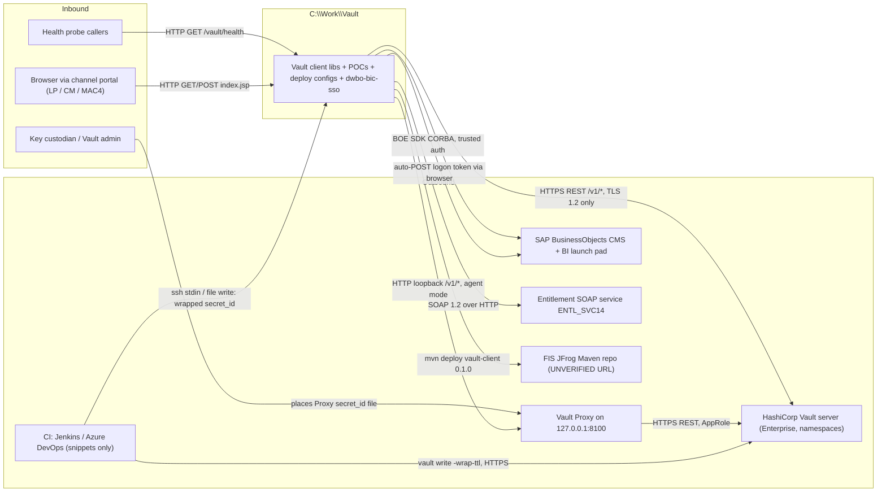
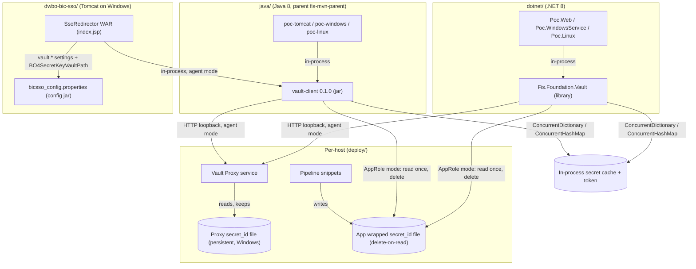
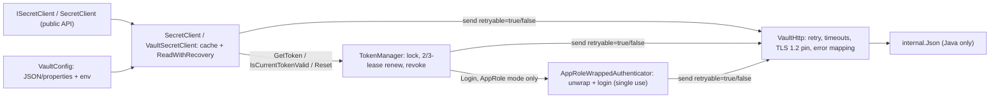

# System Architecture Map (`C:\Work\Vault`)
**Status:** reference — generated by codebase-onboarding on 2026-10-17; verify against the code before relying on it.

All paths are relative to `C:\Work\Vault`. No secret values appear in this document; secrets are named by setting,
env var, or file path only.

**Revision 2026-10-17 (later the same day):** updated for the dwbo-bic-sso Vault integration, the TLS 1.2 pin, the
Windows Vault Proxy changes, and the `fis-mvn-parent` parent POM. It also includes the owner's answers to the
first version's open questions, and links to the revised key storage standard.

The target holds three things:

1. **The Vault secret client** in .NET 8 (`dotnet/`) and Java 8 (`java/`), with POCs and deploy material
   (`deploy/`). The POCs re-implement the current client without NuGet packages and show which AppRole is in use
   (owner, 2026-10-17).
2. **The current C# Snowflake client's Vault code** (root `*.cs`, `Snowflake/`). It uses the VaultSharp NuGet
   package and is kept as an example of today's code (owner, 2026-10-17). It is not built here (`CLAUDE.md`).
3. **`dwbo-bic-sso/`**, the BusinessObjects SSO redirector webapp being remediated. It now uses `vault-client` in
   agent mode to read the BOE trusted-auth secret (`dwbo-bic-sso/pom.xml:206-210`;
   `dwbo-bic-sso/src/main/java/com/fis/bic/sso/helper/SecretKeyStorage.java:85-93`).

**Governing standard (outside this target; named, not explored).** `C:\Work\KEY_AND_KEYSTORE_STORAGE_STANDARD.md`
(status: Proposed) was revised on 2026-10-17. It makes the pattern implemented here the IBSMAS default:
- **§8.4:** Harness deploys only. Applications read Vault at run time through a local Vault Proxy, and the
  Proxy's secret_id is placed by the key custodian.
- **§4:** the Proxy secret_id is CIDR-bound and has a TTL of 90 days or less.
- **§5 rank 1:** names `vault-client`.
- **§9.2:** cites dwbo-bic-sso as the reference implementation.
- **§11 Q14–Q20:** carry the Vault questions from §8 below. They went to Security/Ops in `C:\Work\Draft Email to review.eml`.

---

## 1. Context diagram

Evidence:
- Vault endpoints: `java/vault-client/src/main/java/com/fis/foundation/vault/VaultHttp.java:61`; TLS pin at `:229-251`.
- Proxy listener: `deploy/vault-agent/agent-windows.hcl` (listener stanza); persistent secret_id at `:25-26`.
- CI snippets: `deploy/pipeline/Jenkinsfile.deliver-secret-id.groovy:13-22`.
- dwbo-bic-sso → Proxy: `dwbo-bic-sso/src/main/java/com/fis/bic/sso/helper/SecretKeyStorage.java:93,125-133`.
- BOE logon: `dwbo-bic-sso/src/main/java/com/fis/businessobjects/helper/SessionManager.java:31-39`.
- SOAP: `dwbo-bic-sso/src/main/java/com/fis/entitlements/client/EntitlementServiceClient.java:48-62`.
- JFrog via the parent POM: `java/pom.xml:8-13`.
- Harness only deploys and injects no secrets (owner, 2026-10-17; standard §8.4), so it has no arrow here.

---

## 2. Container diagram

Evidence:
- Project lists: `dotnet/Vault.Client.sln:8-22`; `java/pom.xml` `<modules>`.
- dwbo-bic-sso → vault-client: `dwbo-bic-sso/pom.xml:206-210`; `SecretKeyStorage.java:125-133,146`.
- Cache: `dotnet/src/Vault.Client/SecretClient.cs:36`; `java/vault-client/src/main/java/com/fis/foundation/vault/VaultSecretClient.java:39-40`.
- App secret_id file: `dotnet/src/Vault.Client/AppRoleWrappedAuthenticator.cs:119-136`.
- Proxy secret_id file: `deploy/vault-agent/agent-windows.hcl:25-26`.

---

## 3. Component diagram (Vault client, both languages)

The two libraries share one design (`CLAUDE.md`, "The two languages mirror each other"). The diagram matters to a
newcomer because the auth-failure path is spread across three classes.

Evidence:
- .NET: `dotnet/src/Vault.Client/ISecretClient.cs:23-59`; `dotnet/src/Vault.Client/SecretClient.cs:52-54,149-176`; `dotnet/src/Vault.Client/TokenManager.cs:34,51-61`; `dotnet/src/Vault.Client/VaultHttp.cs:181`.
- Java: `java/vault-client/src/main/java/com/fis/foundation/vault/VaultSecretClient.java:63-65,133-157`; `java/vault-client/src/main/java/com/fis/foundation/vault/VaultHttp.java:62,229-251`.

A component diagram for `dwbo-bic-sso` is omitted, because its flow runs straight through one JSP (§4).

---

## 4. Component inventory

| Path | Responsibility | Inbound callers | Outbound dependencies | Evidence |
|---|---|---|---|---|
| `dotnet/src/Vault.Client/SecretClient.cs` | Public client: KV v2 read, cache, 401/403 recovery, dispose → revoke | POCs | TokenManager, VaultHttp | `SecretClient.cs:30,36,63,135-176` |
| `dotnet/src/Vault.Client/TokenManager.cs` | Token lifecycle under `SemaphoreSlim(1,1)`; lookup/renew/revoke | SecretClient | AppRoleWrappedAuthenticator, VaultHttp | `TokenManager.cs:34,51-61,89,123-133,181` |
| `dotnet/src/Vault.Client/AppRoleWrappedAuthenticator.cs` | Read and delete the wrapped file, unwrap, AppRole login, once only | TokenManager | VaultHttp, local file | `AppRoleWrappedAuthenticator.cs:44-57,66-70,90,119-136` |
| `dotnet/src/Vault.Client/VaultHttp.cs` | HTTP, retry/backoff, timeouts, TLS 1.2 pin, custom CA trust, status→exception | all of the above | Vault / Proxy over HTTP(S) | `VaultHttp.cs:171-206` |
| `dotnet/src/Vault.Client/VaultConfig.cs` | Settings from JSON + env; refuses secret_id; https rule | POCs | — | `VaultConfig.cs:72-84,92-145,177-178,190-212` |
| `dotnet/samples/*` | Web / Windows service / systemd POC hosts + PocCheck | HTTP probe, SCM, systemd | Vault.Client | `Poc.Web/Program.cs:17-38`; `Poc.WindowsService/Program.cs:23-30`; `Poc.Linux/Program.cs:22-29`; `Poc.Common/PocCheck.cs:22-53` |
| `java/vault-client/.../VaultSecretClient.java` | Java mirror of SecretClient | POCs, dwbo-bic-sso `SecretKeyStorage` | TokenManager, VaultHttp | `VaultSecretClient.java:39-82,133-177` |
| `java/vault-client/.../TokenManager.java` | Java token lifecycle, `synchronized` methods | VaultSecretClient | AppRoleWrappedAuthenticator, VaultHttp | `TokenManager.java:36-141` |
| `java/vault-client/.../AppRoleWrappedAuthenticator.java` | Java unwrap + login | TokenManager | VaultHttp, local file | `AppRoleWrappedAuthenticator.java:39-141` |
| `java/vault-client/.../VaultHttp.java` | `HttpURLConnection`, retry, fixed-length streaming, TLS 1.2-only socket factory (`Tls12Only`) | all of the above | Vault / Proxy | `VaultHttp.java:62,229-251` |
| `java/vault-client/.../VaultConfig.java` | Settings from properties + env; unknown keys throw | POCs, dwbo-bic-sso | — | `VaultConfig.java:69-270` |
| `java/vault-client/.../internal/Json.java` | Dependency-free JSON parser/writer | VaultHttp, VaultSecretClient | — | `Json.java:30-34,159,328-330` |
| `java/poc-*` | Daemon loop, Tomcat listener + `/vault/health`, shaded mains, WinSW / systemd units | Tomcat, WinSW, systemd | vault-client | `poc-common/.../PocDaemon.java:38-76`; `poc-tomcat/.../VaultContextListener.java:37-63`; `poc-windows/service/vault-poc.xml:10-33` |
| `deploy/approle-setup.sh` | Admin setup: app policy + app role; optional `AGENT_ROLE` with reusable, CIDR-bound, 2160h secret_id | Vault admin | Vault CLI | `deploy/approle-setup.sh:7-37` |
| `deploy/vault-agent/agent-windows.hcl` | Windows Vault Proxy: AppRole, persistent secret_id file, `127.0.0.1:8100` | `sc.exe` service | Vault | `agent-windows.hcl:8-31` |
| `deploy/vault-agent/agent-linux.hcl`, `vault-agent.service` | Linux Vault Proxy: wrapped, delete-on-read secret_id | systemd | Vault | `agent-linux.hcl:13-40`; `vault-agent.service:8-21` |
| `deploy/pipeline/*` | Mint a wrapped secret_id and deliver it to an **app** host | Jenkins / Azure DevOps | Vault, target host | `Jenkinsfile.deliver-secret-id.groovy:4-23`; `azure-pipelines.deliver-secret-id.yml:4-30` |
| Root `*.cs`, `Snowflake/` | Current C# Snowflake client's VaultSharp `ISecretProvider` (example, not built) | not built | VaultSharp, IMemoryCache, `Fis.Foundation.Logging` | `VaultSecretProvider.cs:14-30,166-180`; `VaultSharpKvReader.cs:18-45,68-73` |
| `dwbo-bic-sso/src/main/webapp/index.jsp` | Whole SSO flow: decrypt SLAPI, entitlement, BOE logon, auto-POST | Browser | SlapiTokenHandler, EntitlementServiceClient, LoginHelper | `index.jsp:21-217` |
| `dwbo-bic-sso/.../helper/SecretKeyStorage.java` | **Reads the BOE trusted-auth secret from Vault** (path from `BO4SecretKeyVaultPath`, key `value`). Lazy `synchronized` client built from allow-listed `vault.*` settings plus `VAULT_*` env | `LoginHelper.java:48` | vault-client (agent mode) | `SecretKeyStorage.java:40-44,85-93,125-155` |
| `dwbo-bic-sso/.../helper/LoginHelper.java`, `businessobjects/helper/*` | BOE trusted-auth logon, admin password reset, logon token | index.jsp | SecretKeyStorage, BOE SDK | `LoginHelper.java:47-116`; `SessionManager.java:31-39` |
| `dwbo-bic-sso/.../security/AESEncryption.java` | Old KEK decryption. **No longer called** from the SSO path | none (dead code) | Certicom AES | `AESEncryption.java:43-46,124-145` |
| `dwbo-bic-sso/.../helper/SlapiTokenHandler.java` | Decrypt the SLAPI federated token per channel | index.jsp | SLAPI lib, key files on disk | `SlapiTokenHandler.java:35-39,65-158` |
| `dwbo-bic-sso/.../entitlements/client/*` | JAX-WS client for ENTL_SVC14 + SOAP logging handler | index.jsp | Entitlement SOAP service | `EntitlementServiceClient.java:40-128`; `SOAPLoggingHandler.java:51-81` |

### 4.1 Snowflake client (VaultSharp) vs `vault-client`

`VaultSharpKvReader.cs` and `VaultSecretProvider.cs` were read directly (Windows-1252). The details for
`VaultLibrarySettings.cs` and `Snowflake/` come from a subagent report and are marked as such.

**How the Snowflake client reads a secret:**
1. `SnowflakeCredentialService.GetAsync(path)` asks the provider for a `SnowflakeCredentials`
   (`Snowflake/SnowflakeCredentialService.cs:51-56`, subagent).
2. `VaultSecretProvider.GetKvSecretAsync<T>` checks `IMemoryCache` (`VaultSecretProvider.cs:107-116`).
3. On a miss, it calls the reader with one retry on auth failure (`:118-120,166-180`).
4. `VaultSharpKvReader.ReadSecretAsync<T>` logs in through AppRole and reads KV v2 with
   `_vaultClient.V1.Secrets.KeyValue.V2.ReadSecretAsync<T>(path, mountPoint: mountPoint)`
   (`VaultSharpKvReader.cs:37-45,55-57`). It deserializes the response straight into `T` (`:61-66`).

| | Snowflake client (VaultSharp NuGet) | `vault-client` / `Fis.Foundation.Vault` |
|---|---|---|
| KV engine and operations | KV **v2**, read latest version only: `V1.Secrets.KeyValue.V2.ReadSecretAsync` (`VaultSharpKvReader.cs:55-57`), unwrapped via `secret.Data.Data` (`:61-66`) | KV **v2**, read latest version only: `GET <kvMount>/data/<path>` (`dotnet/src/Vault.Client/SecretClient.cs:180-181`) |
| Dependencies | VaultSharp, `IMemoryCache`, `Fis.Foundation.Logging` (`VaultSharpKvReader.cs:18-20`) | None (`dotnet/src/Vault.Client/Vault.Client.csproj:3`; `java/vault-client/pom.xml`, test scope only) |
| secret_id | Plaintext, reusable, from the `vaultSettings` config section; required at construction (`VaultSharpKvReader.cs:33`; `VaultLibrarySettings.cs:57,84,112-113`, subagent) | Wrapped and single-use, deleted on read (AppRole mode), or none in the app (agent mode). A plaintext secret_id setting is refused (`dotnet/src/Vault.Client/VaultConfig.cs:141-145,206-209`) |
| TLS | `ServicePointManager.SecurityProtocol = Tls12` for the **whole process** (`VaultSharpKvReader.cs:35`) | TLS 1.2 pinned on the Vault connection only (`dotnet/src/Vault.Client/VaultHttp.cs:181`; `java/.../VaultHttp.java:229-251`) |
| 401 and 403 | Both become `VaultAuthenticationException` (`VaultSharpKvReader.cs:68-73`) | Both become `VaultAuthException`, then are classified (next row) |
| After an auth failure | Reset the token, log in again with the same secret_id, retry once (`VaultSecretProvider.cs:166-180`) | Call `lookup-self`. A valid token means `PermissionDenied`, with no retry. Otherwise reset and retry once (`dotnet/src/Vault.Client/SecretClient.cs:149-176`) |
| Policy denial (403 on a valid token) | Spends a needless login, gets 403 again, and reports "authentication failed" | Reported as `PermissionDenied` at once |
| Cache key | `vault:kv:{mount}:{path}:{TypeName}`, so one path read as two types is cached twice (`VaultSecretProvider.cs:191`) | Normalized path only (`dotnet/src/Vault.Client/SecretClient.cs:71,79`) |
| Cache TTL | min(`KvDefaultTtl`, `KvMaxTtl`), only if `CacheKvSecrets` is on (`VaultSecretProvider.cs:110,122-128`); defaults 5 and 15 min per subagent | `CacheTtl`, default 5 min; 0 disables it (`dotnet/src/Vault.Client/VaultConfig.cs:78`) |
| Result shape | Typed `T` deserialized by VaultSharp | `IReadOnlyDictionary<string,string>` / `Map<String,String>`, plus `GetKey` for byte keys |
| Empty response | `InvalidOperationException`, not a Vault type (`VaultSharpKvReader.cs:61-64`) | `VaultNotFoundException` (`dotnet/src/Vault.Client/SecretClient.cs:183-189`) |
| Token on shutdown | Never revoked. `Dispose()` only disposes the cache, not the VaultSharp client (`VaultSecretProvider.cs:206-219`) | Revoked on dispose in AppRole mode; nothing to revoke in agent mode (`dotnet/src/Vault.Client/TokenManager.cs:123-133`) |

**Why the retry logic differs.** The Snowflake client can treat every 401/403 as "token died, log in
again" only because its secret_id is plaintext and reusable. The new client removed that secret_id, so a
blind re-login is no longer possible, and it asks Vault (`lookup-self`) before deciding.

**KV version.** Both clients use the KV **v2** secrets engine, and only to read the latest version.
- In VaultSharp's call, `V1` is Vault's `/v1/` HTTP API and `KeyValue.V2` is the KV engine version.
- The nested `Data.Data` (`VaultSharpKvReader.cs:61-66`) and the new client's `data.data` check
  (`dotnet/src/Vault.Client/SecretClient.cs:183-189`) both follow the KV v2 response shape.
- Neither client reads a specific version (`?version=N`), writes or patches (including `cas`), reads metadata or
  version history, or soft-deletes, undeletes or destroys.
- Neither works against a KV **v1** mount, which has no `/data/` path segment.
- A rotation is just a new version written in Vault. The clients pick it up when their cache expires.
- The KV v1/v2 details come from HashiCorp's KV documentation (<https://developer.hashicorp.com/vault/docs/secrets/kv>),
  which was **not** opened while writing this note.

### 4.2 KV setup on the real Vault server

No one with Vault access has been asked yet. This machine has no `vault` CLI, no `VAULT_*` variables and no
`~/.vault-token`, so the server was not queried. Everything below comes from files in the repo.

**Established (team notes plus code, not a Vault admin statement):**
- Vault Enterprise with namespaces, AppRole auth, and **KV v2** (`/v1/<mount>/data/<path>`, value at
  `.data.data.<key>`) (`vault-session-notes.md:94-98,119-123`).
- The Snowflake client reads KV v2 only (`VaultSharpKvReader.cs:55-57`).

**Not established:**

| Item | What the repo shows | Evidence |
|---|---|---|
| Mount name | Snowflake client code default `kv`, but the config attribute `kvMountPoint` is **required**, so real deployments set it explicitly and the default proves nothing. The new clients default to `secret`, and the proposed path `secret/ibsmas/<tier>/...` assumes `secret` too | `VaultLibrarySettings.cs:42,103-104`; `dotnet/src/Vault.Client/VaultConfig.cs:54`; `java/.../VaultConfig.java:124`; standard §7 |
| Namespace | Optional in the Snowflake client (`vaultNamespace`), no value in the repo. All samples use `REPLACE-*` | `VaultLibrarySettings.cs:35-37,100-101`; `dotnet/samples/*/vault.json:3-4`; `deploy/vault-agent/agent-*.hcl` |
| Per-tier layout | Proposal only (`dev`/`sys`/`rdy`/`prd`/`dr`) | standard §4 |
| `max_versions`, `cas_required`, `delete_version_after` | NOT FOUND | — |
| How the mount was enabled (`vault secrets enable -version=2 …`) | NOT FOUND. `deploy/approle-setup.sh` creates policies and roles only | `deploy/approle-setup.sh:2-37` |
| A KV v1 mount anywhere | NOT FOUND (v1 appears only as a failure mode) | — |
| Who administers Vault | Unnamed ("Vault admin", "Security/Platform") | standard §4, §7 |
| The real `vaultSettings` values (Snowflake client, RS) | NOT FOUND in this folder | standard §7 |

**Consequence for dwbo-bic-sso:** if the real mount is `kv`, not `secret`, the per-tier
`bicsso_config.properties` must set `vault.kvMount`. The client default (`secret`) would otherwise read the
wrong mount. The policy path in `deploy/policy-app-read.hcl` would also need the right mount name.

**How to settle it.** Ask someone with Vault access, under Q14, to run these in each tier's namespace:
- `vault secrets list -detailed`: the mount name, `type kv`, and `version:2` in Options;
- `vault read <mount>/config`: KV v2 settings.

Alternatively, read the `kvMountPoint` / `vaultNamespace` values from a deployed Snowflake-client config.

---

## 5. External boundaries

| Boundary | Direction | Protocol | Contract | Auth | Config location | Evidence |
|---|---|---|---|---|---|---|
| Vault `sys/wrapping/unwrap` | Out | HTTPS POST (TLS 1.2), not retried | Vault API | Wrapping token in `X-Vault-Token` | `address` / `VAULT_ADDR` | `dotnet/src/Vault.Client/AppRoleWrappedAuthenticator.cs:90`; `java/.../AppRoleWrappedAuthenticator.java:86` |
| Vault `auth/<mount>/login` | Out | HTTPS POST (TLS 1.2), not retried | AppRole login | role_id + unwrapped secret_id | `roleId`/`VAULT_ROLE_ID`, `wrappedSecretIdFile`/`VAULT_WRAPPED_SECRET_ID_FILE` | `dotnet/.../AppRoleWrappedAuthenticator.cs:66-70`; `java/.../AppRoleWrappedAuthenticator.java:61-67` |
| Vault `<kvMount>/data/<path>` | Out | HTTP(S) GET, retried | KV v2 read | Token, or none in agent mode | `kvMount`/`VAULT_KV_MOUNT` | `dotnet/src/Vault.Client/SecretClient.cs:180-181`; `java/.../VaultSecretClient.java:160-161` |
| Vault `auth/token/{lookup,renew,revoke}-self` | Out | HTTP(S) GET / POST | Token API | Current token | — | `dotnet/src/Vault.Client/TokenManager.cs:89,133,181`; `java/.../TokenManager.java:75,100,128` |
| Vault Proxy listener | Out (from libs) / In (to Proxy) | HTTP loopback `127.0.0.1:8100` | Vault API, proxied | Proxy injects its own token (`use_auto_auth_token=force`); `require_request_header` | `deploy/vault-agent/agent-*.hcl` | `deploy/vault-agent/agent-windows.hcl` (`api_proxy`, `listener`) |
| Proxy secret_id file (Windows) | In (custodian places it) | Local file, kept after reading | Raw secret_id | ACL to Proxy account + SYSTEM; role CIDR-bound; 2160h TTL | `C:\vault\secrets\secret-id` | `deploy/vault-agent/agent-windows.hcl:25-26`; `deploy/approle-setup.sh:28-37` |
| App wrapped secret_id file | In (file drop) | Local file, read once + delete | Raw token or CLI JSON `wrap_info.token` | File ACL (0400 / icacls) | `VAULT_WRAPPED_SECRET_ID_FILE` | `dotnet/.../AppRoleWrappedAuthenticator.cs:119-163`; `deploy/pipeline/Jenkinsfile.deliver-secret-id.groovy:21` |
| CI → Vault (mint) | Out (from CI) | Vault CLI, HTTPS | `auth/approle/role/<role>/secret-id`, `-wrap-ttl=10m` | Pipeline identity: NOT FOUND how obtained | pipeline vars | `deploy/pipeline/Jenkinsfile.deliver-secret-id.groovy:2-17`; `deploy/policy-deliverer.hcl:5-9` |
| POC health endpoint | In | HTTP GET `/vault/health` | JSON PocResult / 503 ProblemDetails | None | — | `dotnet/samples/Poc.Web/Program.cs:28-38`; `java/poc-tomcat/.../VaultHealthServlet.java:32-53` |
| SSO entry `index.jsp` | In | HTTP GET/POST | Params `authtkn`, `keytkn`, `channel` | SLAPI token decrypted with channel RSA key | `slapi_config.properties` (outside repo) | `dwbo-bic-sso/src/main/webapp/index.jsp:44-84` |
| **dwbo-bic-sso → Vault (trusted-auth secret)** | Out | HTTP loopback to Proxy, then HTTPS to Vault | KV v2 `secret/ibsmas/<tier>/dwbo-bic-sso/bo4-trusted-auth`, key `value` | Agent mode: no token in app; Proxy AppRole | `vault.*` + `BO4SecretKeyVaultPath` in `bicsso_config.properties`; `VAULT_*` env overrides | `dwbo-bic-sso/src/main/java/com/fis/bic/sso/helper/SecretKeyStorage.java:85-93,125-155`; `dwbo-bic-sso/dwbo-bic-sso-server-runbook-2026-10-15.md` §3.3 |
| Entitlement service ENTL_SVC14 | Out | SOAP 1.2 over HTTP(S) | `src/main/resources/wsdl/ETRetrieveUserApplCatAccessWSV1_SOAP12.wsdl` | In-body basicAuth: user ID + SLAPI `KEY_CREDENTIAL` | `entitltment.endpoint.url` | `dwbo-bic-sso/src/main/java/com/fis/entitlements/client/EntitlementServiceClient.java:48-66,119-128` |
| BOE CMS | Out | BOE Enterprise SDK (CORBA) | SDK `IEnterpriseSession` | Trusted principal + shared secret (now from Vault) | `CMS4Name`, `AdminBO4User` | `dwbo-bic-sso/src/main/java/com/fis/businessobjects/helper/SessionManager.java:31-39`; `.../helper/LoginHelper.java:48-71` |
| BI launch pad | Out (via browser) | HTML form auto-POST | `ivsLogonToken` | BOE logon token | `BIC4ServerName`, `BIC4LaunchPadPath`, `MACSSO4LaunchPadPath` | `dwbo-bic-sso/src/main/webapp/index.jsp:141,185,208-217` |
| JFrog (publish) | Out | Maven deploy | `com.fis.foundation.vault:vault-client:0.1.0` | FIS Maven credentials (`settings.xml`, NOT FOUND on this machine) | inherited from `com.fisglobal:fis-mvn-parent:1.1.1` (UNVERIFIED contents) | `java/pom.xml:8-17` |

### Where secrets and credentials are read (location only)

- **Vault client:**
  - role_id: `roleId` / `VAULT_ROLE_ID`.
  - Wrapped secret_id: the file at `VAULT_WRAPPED_SECRET_ID_FILE`.
  - A plain secret_id setting is refused (`dotnet/src/Vault.Client/VaultConfig.cs:141-145,206-209`; `java/.../VaultConfig.java:179-182,247-250`).
- **Vault Proxy:**
  - Windows: role_id `C:\vault\role-id`; persistent secret_id `C:\vault\secrets\secret-id` (`deploy/vault-agent/agent-windows.hcl:24-26`).
  - Linux: `/etc/vault-agent/role-id` and the wrapped `/run/vault-agent/wrapped-secret-id` (`deploy/vault-agent/agent-linux.hcl:22-23`).
- **dwbo-bic-sso:**
  - Trusted-auth secret: Vault, via the Proxy (`SecretKeyStorage.java:93`). `BO4SecretKey` ciphertext and `BICSSO_BO4_KEK`/`_IV` are no longer read.
  - `BOSecretKey`: still read by the dead `unlockUser` path (`SecretKeyStorage.java` `readConfiguredSecretKey`; `LoginHelper.java:119-128`).
  - SLAPI RSA key files on disk, via `slapi_config.properties`.
- **Snowflake client example:** plaintext `secretId` in the `vaultSettings` config section (`VaultLibrarySettings.cs:57,84,112-113`).

---

## 6. Build & run

Run status as of this revision:
- The two `VaultHttp` test classes ran green, before the parent POM change.
- `SecretKeyStorageTest` ran 4/4 green, but via `javac` with stand-in `BicLogger`/`BicssoConstants`, not through Maven.

| Command | Purpose | Source |
|---|---|---|
| `dotnet build dotnet\Vault.Client.sln` | Build .NET library, tests, POCs | `CLAUDE.md` (Commands) |
| `dotnet test dotnet\tests\Vault.Client.Tests` | .NET unit tests; integration tests skip unless env vars are set | `CLAUDE.md`; `dotnet/tests/Vault.Client.Tests/IntegrationTests.cs:21-62` |
| `mvn -f java\pom.xml verify` | Build + test all Java modules. **Needs FIS `settings.xml`** to resolve `fis-mvn-parent`; fails on this machine | `CLAUDE.md`; `java/pom.xml:8-13` |
| `mvn -f java\pom.xml deploy` | Publish vault-client 0.1.0 to JFrog (run by the owner) | `java/pom.xml:17`; distribution config inherited (UNVERIFIED) |
| `mvn -f dwbo-bic-sso\pom.xml test` | dwbo-bic-sso tests incl. `SecretKeyStorageTest`. Needs FIS repo access **and** vault-client 0.1.0 published | `dwbo-bic-sso/pom.xml:6-10,206-210` |
| `deploy/approle-setup.sh` (`VAULT_ADDR`, `VAULT_NAMESPACE`, `APP`, `ROLE`, `SERVER_CIDRS`, optional `AGENT_ROLE`) | Vault admin setup | `deploy/approle-setup.sh:5-7,28` |
| `vault proxy -config=...` (systemd / `sc.exe`) | Run Vault Proxy | `deploy/vault-agent/vault-agent.service:10`; `deploy/vault-agent/agent-windows.hcl` header |

**Toolchain:**
- .NET: `net8.0`, no PackageReferences in the library (`dotnet/src/Vault.Client/Vault.Client.csproj:3-8`).
- Java: source/target 1.8, parent `com.fisglobal:fis-mvn-parent:1.1.1`, version `0.1.0` (`java/pom.xml:8-17`). What the parent configures is UNVERIFIED, because its POM is not cached locally.
- dwbo-bic-sso: Java 8, same parent (`dwbo-bic-sso/pom.xml:6-10,18-19`).

**CI:** there is no pipeline that builds `dotnet/` or `java/` (owner, 2026-10-17). `deploy/pipeline/` only delivers secret_ids. Harness deploys dwbo-bic-sso and does nothing else.

---

## 7. Critical invariants & gotchas

1. **A 401/403 is classified with `lookup-self`, never retried blindly.**
   - Evidence: `dotnet/src/Vault.Client/SecretClient.cs:149-176`; `java/vault-client/src/main/java/com/fis/foundation/vault/VaultSecretClient.java:133-157`.
   - In AppRole mode, the one retry path always fails, because the wrapped secret_id is single-use. Agent mode, which dwbo-bic-sso uses, does not have this limit: the Proxy logs in again by itself.
2. **"TLSv1.2" in Java is only a cap unless every socket is narrowed.**
   - On Java 8, `SSLContext.getInstance("TLSv1.2")` still enables TLS 1.0 and 1.1 on client sockets.
   - The `Tls12Only` wrapper calls `setEnabledProtocols({"TLSv1.2"})` on every socket, in both trust paths (`java/.../VaultHttp.java:62,229-251`). .NET sets `EnabledSslProtocols = Tls12` (`dotnet/src/Vault.Client/VaultHttp.cs:181`).
   - Tests: `java/vault-client/src/test/java/com/fis/foundation/vault/VaultHttpTest.java`; `dotnet/tests/Vault.Client.Tests/VaultHttpTests.cs`.
   - Consequence: TLS 1.3 to Vault is refused.
3. **`VaultConfig.applyProperties` throws on unknown keys,** so dwbo-bic-sso passes only allow-listed `vault.*` settings.
   - Evidence: `java/.../VaultConfig.java:158-163,251-252`; `SecretKeyStorage.java:44-46,146-155`.
   - AppRole settings (`roleId`, `wrappedSecretIdFile`) are left out on purpose, so a config entry cannot switch the app out of agent mode.
   - Blank values are skipped, so they cannot override `VAULT_*` env vars.
4. **The Windows and Linux Proxies handle secret zero differently.**
   - Windows keeps an unwrapped, reusable secret_id. It is CIDR-bound and expires after 2160h, so it must be rotated about every 90 days. Evidence: `deploy/vault-agent/agent-windows.hcl:8-11,25-26`; `deploy/approle-setup.sh:28-37`.
   - Linux still deletes a wrapped secret_id on read (`deploy/vault-agent/agent-linux.hcl:23-26`). Every Linux Proxy restart therefore needs a new delivery, and nothing in `deploy/` performs it.
   - An expired Windows secret_id does **not** stop a running Proxy, because the periodic token it already holds (`token_period=24h`, `deploy/approle-setup.sh:31`) keeps renewing. Every SSO login fails with `VaultAuthException` / `VaultPermissionDeniedException` only when the Proxy next has to log in again: after a restart, a reboot, or a lost token. The failure is therefore latent. This is inferred from AppRole semantics and is UNVERIFIED against a live Vault.
   - The 2160h TTL matches the standard: its §4 matrix caps the Proxy secret_id at 90 days in Readiness, Production and DR, and its §8.4 forbids delivering it through a pipeline.
5. **dwbo-bic-sso still has state shared across requests.**
   - `SingleSignOnEvents.login` is an unsynchronized field on a static singleton (`dwbo-bic-sso/src/main/java/com/fis/bic/sso/helper/SingleSignOnEvents.java:14,38-40`; `index.jsp:133,178`).
   - `EncryptedProperties.properties` is null until the singleton's constructor runs, so any early `setProperty` throws an NPE (`dwbo-bic-sso/src/main/java/com/fis/bic/sso/utility/EncryptedProperties.java:27-28,84`).
   - The full SLAPI XML token is logged at debug (`index.jsp:80` via `BicLogger.java:86-87`).
   - The silent `"error"` return in `AESEncryption` (`AESEncryption.java:143-144`) is no longer on the login path.

---

## 8. Open questions

Answered by the owner on 2026-10-17 and removed: Vault client consumers (there are none outside the POCs), CI for the
clients (there is none), the TLS direction (both pin 1.2), whether dwbo-bic-sso adopts the client (yes), and Harness's role (deploy only).

Questions 2–9 were sent to Security/Ops as Q14–Q20 of the standard's §11 (the matching number is in brackets).
Questions 1 and 10–12 are for the code owners and stay here.

1. Which port does Poc.Web bind? There is no `launchSettings.json` or `appsettings.json`, and the owner doesn't know.
2. Linux Proxy: who delivers the wrapped secret_id, and how is the Linux agent role created? Or should Linux move to the Windows persistent-file model? [Q18]
3. How do the Jenkins and Azure pipelines get their own Vault token for the deliverer policy (`deploy/pipeline/Jenkinsfile.deliver-secret-id.groovy:2`)? [Q19]
4. Does the Azure job running on the target VM undercut the two-path secret-zero split (`vault-session-notes.md:71-73,88`)? [Q19]
5. Does `token_bound_cidrs=${SERVER_CIDRS}` survive a proxy or load balancer between the Vault Proxy and Vault (`deploy/approle-setup.sh:18,32`)? Still to be worked out. [Q17]
6. What does `fis-mvn-parent:1.1.1` configure (repositories, `distributionManagement`, compiler and surefire settings, enforcer rules), and does it change the vault-client build or tests? [Q20]
7. Which Vault namespace and `vault.kvMount` apply per tier for dwbo-bic-sso? Is the real KV v2 mount named `kv` (the Snowflake client's code default) or `secret` (the new client default and the proposed path)? See §4.2. Who creates `secret/ibsmas/<tier>/dwbo-bic-sso/bo4-trusted-auth` and the agent role per tier? [Q14]
8. Who rotates the Windows Proxy secret_id every 90 days, and is the expiry monitored? [Q15]
9. When is the BOE trusted-auth secret rotated in the CMC and Vault together? The old KEK that protects the current value is in git history. [Q16]
10. Where are `BicssoConstants`, `ISlapiToken`, `ISingleSignOnConfiguration` and `IBusinessObjectsSecretKey` defined? The DW biplugins jar is suspected.
11. What do the `createLogonToken("", 1, 1)` arguments mean (`dwbo-bic-sso/src/main/java/com/fis/bic/sso/helper/LoginHelper.java:71`)?
12. Who supplies the servlet API for dwbo-bic-sso? It is not in the POM, so presumably Tomcat (UNVERIFIED).
