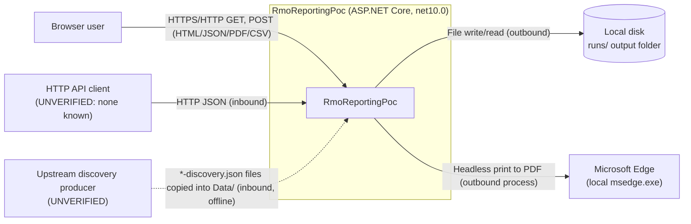
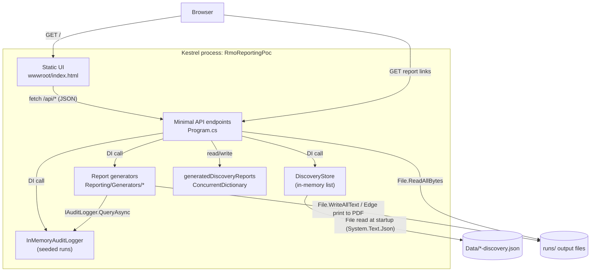

# RmoReportingPoc System Map

**Status:** reference — generated by codebase-onboarding on 2026-10-04, last updated 2026-10-04 for the single readiness report and reason wording; verify against the code before relying on it.

Scope: `C:\Work\rmo\poc`, excluding build output (`bin/`, `obj/`, `.vs/`), generated output (`runs/`) and
AI-tooling folders (`.agent/`, `.agents/`, `.claude/`, `.codex/`, `.gemini/`, `.impeccable/`, `.opencode/`).

## 1. Context diagram

The app makes no outbound network calls; its only outbound process is headless Edge, started to print PDFs. It has no database, no queue and no HTTP client (`NOT FOUND` in any
`.cs` under scope). BusinessObjects, Oracle and Snowflake appear only as data fields, not as live connections
(`Core/Domain/DataProviderInfo.cs:13-27`).

## 2. Container diagram

There is one deployable unit: the web host started by `Program.cs:9` and `Program.cs:165`. There are no
services, COM servers, scheduled jobs or consumers (`NOT FOUND`).

## 3. Component diagram

Omitted. The container is small enough that the inventory table below covers its internals.

## 4. Component Inventory Table

| Path | Responsibility | Inbound Callers | Outbound Dependencies | Evidence |
|---|---|---|---|---|
| `Program.cs` | Host boot, DI registration, all HTTP endpoints | Kestrel host; `wwwroot/index.html` fetches | All services below; local disk | `Program.cs:9-32`, `Program.cs:34-171` |
| `wwwroot/index.html` | Static UI: lists discoveries and runs, links to reports | Browser | `/api/discoveries`, `/api/discoveries/{id}/report/readiness`, `/api/discoveries/{id}/report/readiness/pdf`, `/api/runs`, `/api/runs/{id}/report` | `wwwroot/index.html:48-49`, `wwwroot/index.html:85-86` |
| `DiscoveryStore.cs` | Loads `Data/*-discovery.json` once in its constructor; serves lookups | `Program.cs:34-114` | Local disk (`Data/`) | `DiscoveryStore.cs:13-30`, `DiscoveryStore.cs:32-34` |
| `Core/Stubs/InMemoryAuditLogger.cs` | Stand-in `IAuditLogger`; seeds two runs | `Program.cs:116-163`; all `IReportGenerator`s | None | `Core/Stubs/InMemoryAuditLogger.cs:9-18`, `:20-27` |
| `Core/Stubs/StubConfigurationProvider.cs` | Stand-in `IConfigurationProvider`; sets `OutputRoot = <content root>/runs` | `HtmlDiscoveryReportGenerator`, `HtmlDiscoveryDashboardGenerator` | `IHostEnvironment` | `Core/Stubs/StubConfigurationProvider.cs:11-19` |
| `Core/Abstractions/*` | RMO interfaces: `IAuditLogger`, `IConfigurationProvider`, `IReportGenerator`, `IDiscoveryReportGenerator` | Generators, stubs, `Program.cs` | None | `Core/Abstractions/IAuditLogger.cs:9-12`, `Core/Abstractions/IReportGenerator.cs:7-12`, `Core/Abstractions/IDiscoveryReportGenerator.cs:7-10`, `Core/Abstractions/IConfigurationProvider.cs:5-8` |
| `Core/Domain/*` | DTOs: `AuditEvent`, `MigrationDiscovery`, `MigrationDocument`, `JobInfo`, `ScheduleInfo`, `DataProviderInfo`, CHAR findings | Everything | None | `Core/Domain/AuditEvent.cs:3-16`, `Core/Domain/MigrationDiscovery.cs:3-20` |
| `Core/Domain/AuditEventExtensions.cs`, `Core/Domain/AuditOutcome.cs` | `AuditEvent.Classify()` outcome rule (Migrated / Skipped / Failed / Lifecycle) | `Program.cs:126-128`; `HtmlReportGenerator` | None | `Core/Domain/AuditEventExtensions.cs:9-16`, `Core/Domain/AuditOutcome.cs:3-12` |
| `Reporting/Generators/HtmlReportGenerator.cs` | `format=html`: run report (summary counts by `Classify`, then per-type and per-event detail); also the source HTML for the run PDF | `Program.cs:139` dispatch; `PdfReportGenerator` | `IAuditLogger`; writes `report.html` | `Reporting/Generators/HtmlReportGenerator.cs:37-40`, `:50-56`, `:59-66` |
| `Reporting/Generators/HtmlDiscoveryDashboardGenerator.cs` | Customer readiness report, one file: summary (job impact, converting/not split, reasons) then both detail sections | `Program.cs:93`, `Program.cs:107` (concrete type, `Program.cs:25`) | `IConfigurationProvider`; `ConversionReasons`; `DiscoveryReportSections`; writes `runs/discovery/<hc>/<wave>/reports/*-readiness.html` | `Reporting/Generators/HtmlDiscoveryDashboardGenerator.cs:29-160` |
| `Reporting/Generators/DiscoveryReportSections.cs` | The two detail sections: will not convert (by reason) and will convert (by Snowflake universe), each with drill-down, appendix and print-only copy; converting reports also show each finding's full before/after definition (screen only) | `HtmlDiscoveryDashboardGenerator` | `ConversionReasons`; `DiscoveryReportShared` | `Reporting/Generators/DiscoveryReportSections.cs:18-341` |
| `Reporting/Generators/DiscoveryReportShared.cs` | Shared CSS (screen, mobile, print), header/footer, job join and trailing-space rendering | the two files above | None | `Reporting/Generators/DiscoveryReportShared.cs:14-215` |
| `Reporting/Generators/PdfReportGenerator.cs` | `format=pdf`: writes the HTML run report, then prints it with Edge | `Program.cs:139` dispatch | `HtmlReportGenerator`; `EdgePdfPrinter`; writes `report.html` and `report.pdf` | `Reporting/Generators/PdfReportGenerator.cs:27-34` |
| `Reporting/Generators/EdgePdfPrinter.cs` | Prints a self-contained HTML file to PDF with headless Edge (own temp profile per print, document outline from headings), then uses PDFsharp to drop the duplicate side-navigation links Chromium repeats on every page | `PdfReportGenerator`; `Program.cs:109-110` | `msedge.exe` under Program Files; PDFsharp | `Reporting/Generators/EdgePdfPrinter.cs:16-22`, `:28`, `:87-140` |
| `Reporting/Generators/ExcelReportGenerator.cs` | `format=csv` and `format=xlsx` (both CSV) | `Program.cs:139` dispatch | `IAuditLogger`; writes `report.csv` / `report.xlsx.csv` | `Reporting/Generators/ExcelReportGenerator.cs:31-34`, `:48-49` |
| `Reporting/Generators/HtmlDiscoveryReportGenerator.cs` | Discovery report HTML | `Program.cs:61`, `Program.cs:76` | `IConfigurationProvider`; writes `runs/discovery/<hc>/<wave>/reports/*.html` | `Reporting/Generators/HtmlDiscoveryReportGenerator.cs:24-54` |
| `Core/Domain/ConversionReason.cs` | `ReasonCode` resolver (explicit code first, `StatusMessage` text fallback) and customer wording catalogue (title, explanation, action, action owner per code) | `HtmlDiscoveryDashboardGenerator`, `DiscoveryReportSections` | None | `Core/Domain/ConversionReason.cs:4-103` (catalogue `:25-64`) |
| `Data/*-discovery.json` | Sample discovery artifacts; contract in `docs/data/discovery.schema.json` and `docs/data/DISCOVERY_JSON.md` | `DiscoveryStore` | None | `Data/20261001202032371-discovery.json:2-6`, `RmoReportingPoc.csproj:19` |

## 5. External Boundaries Table

| Boundary | Direction | Protocol | Contract | Auth | Config Location | Evidence |
|---|---|---|---|---|---|---|
| `GET /api/discoveries` | Inbound | HTTP JSON | Anonymous projection of `MigrationDiscovery` | None (`NOT FOUND`: no auth middleware) | URLs in `Properties/launchSettings.json:9` | `Program.cs:34-45` |
| `GET /api/discoveries/{id}` | Inbound | HTTP JSON | `MigrationDiscovery` | None | same | `Program.cs:47-51` |
| `POST /api/discoveries/{id}/report` | Inbound | HTTP JSON | `{ Path }` (absolute server path) | None | same | `Program.cs:53-64` |
| `GET /api/discoveries/{id}/report/view` | Inbound | HTTP HTML | Generated discovery HTML | None | same | `Program.cs:66-82` |
| `GET /api/discoveries/{id}/report/readiness` | Inbound | HTTP HTML | Readiness report HTML: summary plus both detail sections in one file (customer-facing, no JS, prints as one PDF) | None | same | `Program.cs:85-96` |
| `GET /api/discoveries/{id}/report/readiness/pdf` | Inbound | HTTP PDF (inline) | Regenerates the readiness HTML and prints it with Edge to `<stem>-readiness.pdf` beside it | None | same | `Program.cs:98-114` |
| `GET /api/runs` | Inbound | HTTP JSON | `{ RunId, Total, Succeeded, Skipped, Failed }` | None | same | `Program.cs:116-133` |
| `GET /api/runs/{runId}/report?format=` | Inbound | HTTP HTML/PDF/CSV | `html`, `pdf` (inline), `csv`, `xlsx` | None | same | `Program.cs:135-163`, `Program.cs:167-171` |
| Static files (`/`, `index.html`) | Inbound | HTTP | `wwwroot/` | None | default static file middleware | `Program.cs:31-32` |
| `Data/*-discovery.json` | Inbound (file) | JSON on disk, read once at startup | `MigrationDiscovery` (case-insensitive) | Filesystem ACLs (`UNVERIFIED`) | `<ContentRoot>/Data` | `DiscoveryStore.cs:9`, `DiscoveryStore.cs:15-29` |
| `runs/` output | Outbound (file) | File write | HTML, PDF, CSV | Filesystem ACLs (`UNVERIFIED`) | `Program.cs:151`; `Core/Stubs/StubConfigurationProvider.cs:15` | `Reporting/Generators/HtmlDiscoveryReportGenerator.cs:27-30` |
| Microsoft Edge | Outbound (process) | `msedge.exe --headless=new --print-to-pdf` | HTML file in, PDF file out; non-zero exit, missing or truncated PDF throw | n/a | Fixed paths under Program Files (`Reporting/Generators/EdgePdfPrinter.cs:18-22`) | `Reporting/Generators/EdgePdfPrinter.cs:87-140` |

Secrets and credentials: `NOT FOUND`. There is no `appsettings*.json`, user-secrets ID, connection string or
environment variable read in scope. The only environment variable set anywhere is `ASPNETCORE_ENVIRONMENT`
(`Properties/launchSettings.json:7`).

## 6. Build & Run

| Command | Source |
|---|---|
| `dotnet build RmoReportingPoc.csproj` | `CLAUDE.md` "Build and run"; project file `RmoReportingPoc.csproj:1` |
| `dotnet run --project RmoReportingPoc.csproj` (profile `RmoReportingPoc`: https://localhost:5326, http://localhost:5327) | `CLAUDE.md` "Build and run"; `Properties/launchSettings.json:3-9` |
| Solution: `RmoReportingPoc.slnx` (single project) | `RmoReportingPoc.slnx:1-3` |
| Tests | `NOT FOUND`: no test project in scope |
| Lint | `NOT FOUND`: no analyzer config, `.editorconfig` or lint script in scope |
| CI | `NOT FOUND`: no `Jenkinsfile`, `azure-pipelines.yml` or build script in scope |

Toolchain: SDK `Microsoft.NET.Sdk.Web`, `net10.0`, nullable and implicit usings enabled
(`RmoReportingPoc.csproj:1-6`). The only package is `PDFsharp` 6.2.4 (`RmoReportingPoc.csproj:11`), used only to post-process
Edge-printed PDFs. PDF output needs Microsoft Edge installed, so it works on Windows only
(`Reporting/Generators/EdgePdfPrinter.cs:18-22`). Logging is the framework default from
`WebApplication.CreateBuilder` (`Program.cs:9`), and no custom logging setup was found.

## 7. Critical Invariants & Gotchas

1. **The response content type is chosen separately from the generator.** The endpoint dispatches by
   `CanGenerate` (`Program.cs:139`) but picks the MIME type in a separate switch whose fallback is CSV
   (`Program.cs:155-162`). A new format that isn't added to the switch downloads as `report.xlsx.csv`.
2. **A run's outcome comes from `Classify`, not from `Success`.** Skipped events have `Success = true`
   (`Core/Stubs/InMemoryAuditLogger.cs:39-40`). `/api/runs` and the HTML run report (and so
   the run PDF) use `Classify` (`Core/Domain/AuditEventExtensions.cs:9`; callers `Program.cs:126-128`,
   `Reporting/Generators/HtmlReportGenerator.cs:61-66`). The CSV report shows only the raw `Success` column,
   with no summary counts.
3. **State is in memory and lost on restart.** Seeded run timestamps are computed from `UtcNow` when the
   singleton is built (`Core/Stubs/InMemoryAuditLogger.cs:16-17`). Discovery data is read only once, at startup
   (`DiscoveryStore.cs:13-30`). Cached discovery report paths are held in memory only (`Program.cs:29`).
4. **HTML encoding is inconsistent.** The discovery-side generators encode values
   (`Reporting/Generators/HtmlDiscoveryReportGenerator.cs:57`,
   `Reporting/Generators/DiscoveryReportShared.cs:126`), and so does `HtmlReportGenerator`
   (`Reporting/Generators/HtmlReportGenerator.cs:70-74`). `index.html` also interpolates API values into
   `innerHTML` (`wwwroot/index.html:56-68`). Discovery output folders come from `HoldingCompany` and `WaveId`
   with only spaces replaced, in both the inventory report and the readiness report
   (`Reporting/Generators/HtmlDiscoveryReportGenerator.cs:28`, `Reporting/Generators/HtmlDiscoveryReportGenerator.cs:58`,
   `Reporting/Generators/DiscoveryReportShared.cs:17`, `Reporting/Generators/DiscoveryReportShared.cs:117`).

5. **The readiness report must work as a printed file.** It is one self-contained page with no JavaScript, and
   browsers never print closed `
`. So every drill-down in `DiscoveryReportSections` has a `.print-only`
   flat copy, shown only in print (`Reporting/Generators/DiscoveryReportShared.cs:167`,
   `Reporting/Generators/DiscoveryReportShared.cs:219`). Any new collapsible content needs the same pairing, or it
   disappears from the PDF.

## 8. Open Questions

- What system produces the `*-discovery.json` files, and on what schedule? Only samples exist in `Data/`; the
  producer is `UNVERIFIED`.
- What will replace `InMemoryAuditLogger` and `StubConfigurationProvider` in the real RMO? There are no
  production implementations in scope (`NOT FOUND`).
- Does anything other than `wwwroot/index.html` call the HTTP API? No other client was found in scope
  (`UNVERIFIED`).
- Is authentication or authorization planned? None is configured (`NOT FOUND`: no `UseAuthentication` /
  `UseAuthorization` in `Program.cs`).
- How are tests, lint and CI meant to run for this code? None exist in scope (`NOT FOUND`).
- Who should have write access to `runs/` and `Data/` when this is deployed? Filesystem permissions are
  `UNVERIFIED`.
- Who signs off the customer reason wording in `Core/Domain/ConversionReason.cs`? Several actions commit FIS
  to act (re-run discovery, add a folder mapping, review unknown reasons), and the wording has not been reviewed
  (`docs/data/DISCOVERY_JSON.md` §8.2).
- Can two requests for the same report race on one output file in practice? Each request regenerates and overwrites
  a fixed file with no locking: `runs/<runId>/report.*` (`Program.cs:136-138`,
  `Reporting/Generators/HtmlReportGenerator.cs:49`) and `<stem>-readiness.html` (`Program.cs:96`,
  `Reporting/Generators/HtmlDiscoveryDashboardGenerator.cs:35`). The race is inferred from the code and hasn't
  been reproduced (`UNVERIFIED`).
